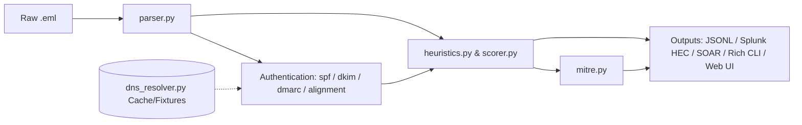

# MailGuard Architecture & Data Flow

MailGuard is a defensive email authentication and spoofing analyzer built for SOC triage.

## 1. System Data Flow

## 2. Core Models (`mailguard/models.py`)

- `ParsedEmail`: Canonical representation (RFC5322/2822 headers, hops, body, URLs, attachments, raw bytes).
- `SPFResult`, `DKIMResult`, `DMARCResult`, `AlignmentResult`: Cryptographic & policy verification states.
- `HeuristicFinding`: Behavioral indicators with IDs, severity, weight, evidence, and MITRE references.
- `Verdict` (`LEGITIMATE`, `SUSPICIOUS`, `SPOOFED`) & `RecommendedAction` (`ALLOW`, `QUARANTINE_AND_REVIEW`, `ESCALATE_TO_SOC`).
- `AnalysisResult`: Complete immutable envelope for reporting, Splunk forwarding, and SOAR ingestion.

## 3. Module Responsibilities

| Module | Core Responsibility |
| :--- | :--- |
| `parser.py` | Safe MIME extraction, hop analysis, originating IP, bounds checks. |
| `dns_resolver.py` | Unified DNS interface; TTL caching; offline fixture resolver. |
| `spf_check.py` | RFC 7208 evaluation via pyspf (pass, fail, softfail, permerror). |
| `dkim_check.py` | RFC 6376 verification on raw bytes; body hash & key check via dkimpy. |
| `alignment.py` | RFC 7489 relaxed/strict alignment via offline `tldextract`. |
| `dmarc_check.py` | RFC 7489 policy evaluation; org domain fallback; pct enforcement. |
| `heuristics.py` | Typo/combosquatting, URL scheme/shortener, double ext, homoglyphs. |
| `scorer.py` | 0–100 risk score, correlation dampening, verdict & action derivation. |
| `mitre.py` | Evidence-based mapping to T1566, T1672, T1534 ATT&CK techniques. |
| `splunk_forwarder.py`| Local JSONL persistence (`output/results.jsonl`) & Splunk HEC delivery. |
| `soar_export.py` | Standalone SOC playbook ticket generation schema. |
| `report.py` | Rich terminal tables, structured JSON, styled HTML reports. |
| `cli.py` & `web.py` | CLI subcommands & secure Flask triage web interface. |
