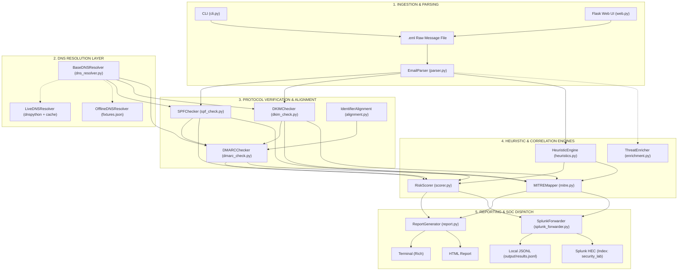

# MailGuard Architecture & Data Flow

This document details the modular architecture, component responsibilities, and end-to-end data pipeline of **MailGuard**.

---

## 1. System Architecture Diagram

---

## 2. Module Responsibilities

| Module | Core Responsibility |
| :--- | :--- |
| `mailguard.parser` | Parses raw bytes/EML files with bounds checks, decodes MIME words, extracts URLs & attachments, inspects Received hops for originating IP, detects header anomalies. |
| `mailguard.dns_resolver` | Provides a unified DNS interface with caching, timeout resilience, and deterministic offline fixture injection for zero-internet testing. |
| `mailguard.spf_check` | Evaluates SPF against candidate client IP and envelope Return-Path via `pyspf`. Handles softfail, permerror, and header fallbacks. |
| `mailguard.dkim_check` | Cryptographically verifies RSA/Ed25519 signatures on raw bytes using `dkimpy`. Distinguishes body hash mismatch from signature mismatch and checks expirations. |
| `mailguard.alignment` | Computes strict and relaxed organizational domain alignment using an offline Public Suffix List extractor (`tldextract`). |
| `mailguard.dmarc_check` | Evaluates RFC 7489 policies (`none`, `quarantine`, `reject`), subdomain inheritance (`sp=`), enforcement percentages (`pct=`), and alignment conditions. |
| `mailguard.heuristics` | Inspects 17+ behavioral attack indicators: typosquatting (rapidfuzz), homoglyphs, brand combosquatting, link mismatches, shorteners, dangerous attachments. |
| `mailguard.scorer` | Computes explainable 0–100 risk score with correlation dampening, assigns defensive verdicts (`LEGITIMATE`, `SUSPICIOUS`, `SPOOFED`), and ranks top reasons. |
| `mailguard.mitre` | Maps observed cryptographic and behavioral evidence to MITRE ATT&CK enterprise techniques (`T1672`, `T1566.001`, `T1566.002`). |
| `mailguard.enrichment` | Optional OSINT reputation lookups (AbuseIPDB, VirusTotal, URLScan) with strict privacy boundaries and in-memory TTL caching. |
| `mailguard.splunk_forwarder`| Dual-path SOC forwarder: guaranteed local JSONL logging with retry-enabled Splunk HEC HTTP streaming. |
| `mailguard.report` | Renders interactive Rich terminal tables, structured JSON schemas, and standalone styled HTML reports. |
| `mailguard.cli` | Orchestrates analysis workflow across CLI subcommands (`analyze`, `analyze-dir`, `web`). |
| `mailguard.web` | Lightweight Flask SOC dashboard with CSRF protection, file upload limits, and JSON export. |

---

## 3. End-to-End Pipeline Execution

1. **Ingestion & Validation**:
   The input `.eml` file is read into memory. If the file size exceeds `limits.max_message_bytes` (25MB), execution halts with a defensive error.

2. **MIME Parsing**:
   Headers, body parts, URLs, and attachments are extracted. The Received header chain is scanned to identify the external client IP while skipping private IP blocks and configured internal mail gateways.

3. **Authentication Verification**:
   - `SPFChecker` verifies whether the sender IP is permitted by the Return-Path domain.
   - `DKIMChecker` looks up the public key TXT record for each signature selector and cryptographically verifies the raw bytes.
   - `IdentifierAlignment` checks whether the authenticated identities match the user-visible `From:` header.
   - `DMARCChecker` queries the domain's DMARC policy and determines whether SPF or DKIM passed with alignment.

4. **Heuristic Detection**:
   The `HeuristicEngine` executes all behavioral rules (e.g. testing for lookalike typosquatting against configured trusted brands, inspecting anchor text vs href destination, detecting double-extension attachments).

5. **Risk Scoring**:
   The `RiskScorer` combines authentication failures and heuristic weights, applies correlation dampening to brand indicators, clamps the score to [0, 100], and maps the numerical score to `LEGITIMATE` (0–30), `SUSPICIOUS` (31–69), or `SPOOFED` (70–100).

6. **Reporting & Ingestion**:
   The record is appended to `output/results.jsonl`. If configured, it is posted to Splunk HEC. Formatted terminal, JSON, or HTML output is presented to the analyst.
